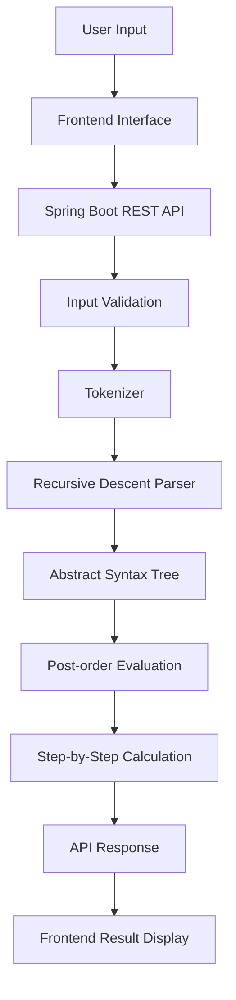

# Math Notes Solver – System Architecture

## 1. Overview

Math Notes Solver is a mathematical expression-processing application inspired by Apple Math Notes.

The application allows users to enter mathematical expressions, process them through a structured parsing and evaluation pipeline, and view step-by-step calculations.

The system combines a frontend interface with a Spring Boot backend to process expressions and return calculated results.

## 2. System Architecture

The application follows a frontend-backend architecture.

### Main Components

**1. Frontend**
- Provides the user interface for entering mathematical expressions.
- Sends expressions to the backend.
- Displays processed expressions and step-by-step calculations.
- Handles user interactions and displays errors.

**2. Spring Boot Backend**
- Receives mathematical expressions through REST APIs.
- Validates the input.
- Coordinates tokenization, parsing and evaluation.
- Returns calculated results and intermediate steps to the frontend.

**3. Expression Processing Engine**
- Converts mathematical expressions into tokens.
- Uses a recursive-descent parser to understand expression structure.
- Generates an Abstract Syntax Tree (AST).
- Evaluates the AST using post-order traversal.
- Maintains operator precedence and associativity.

**4. Evaluation Module**
- Processes arithmetic operations.
- Evaluates expressions using the generated AST.
- Generates intermediate calculation steps.
- Handles invalid expressions and division-by-zero errors.

## 3. System Workflow

The application follows this processing pipeline:

1. The user enters a mathematical expression in the frontend.
2. The frontend sends the expression to the Spring Boot backend.
3. The backend validates the input.
4. The tokenizer converts the expression into meaningful tokens.
5. The recursive-descent parser analyses the tokens.
6. An Abstract Syntax Tree (AST) is generated.
7. The evaluator traverses the AST using post-order traversal.
8. Mathematical operations are performed in the correct order.
9. Intermediate steps and the final result are returned to the frontend.
10. The frontend displays the calculations to the user.

## 4. Architecture Diagram

## 5. Core Algorithms and Concepts

### Tokenization

Tokenization breaks a mathematical expression into smaller meaningful units called tokens.

For example:

Expression: `12 + 5 * 2`

Tokens:
- 12 – Number
- + – Operator
- 5 – Number
- * – Operator
- 2 – Number

### Recursive-Descent Parsing

The parser processes tokens according to grammar rules and operator precedence.

It builds a tree structure representing the mathematical expression.

### Abstract Syntax Tree (AST)

An AST represents the logical structure of an expression.

For example:

Expression: `2 + 3 * 4`

The multiplication operation becomes a child operation of the addition node, ensuring that multiplication is evaluated first.

### Post-order Traversal

Post-order traversal visits:
1. Left subtree
2. Right subtree
3. Root node

This allows the evaluator to calculate child expressions before performing the parent operation.

## 6. Error Handling

The application handles invalid mathematical expressions and evaluation errors, including:

- Invalid input.
- Missing operands.
- Incorrect operator placement.
- Division by zero.
- Malformed expressions.

These checks help prevent invalid calculations and provide meaningful feedback to users.

## 7. Technology Stack

| Component | Technology |
|---|---|
| Frontend | Project frontend framework |
| Backend | Java, Spring Boot |
| API Communication | REST API |
| Parsing | Recursive-Descent Parser |
| Expression Representation | Abstract Syntax Tree |
| Evaluation | Post-order Traversal |
| Core Concepts | Data Structures and Algorithms |

## 8. Future Improvements

Potential improvements include:

- Support for quadratic and polynomial equations.
- Support for trigonometric and logarithmic expressions.
- Enhanced mathematical notation handling.
- More advanced equation-solving capabilities.
- Improved error messages and input validation.
- Support for additional mathematical functions.

## 9. Conclusion

Math Notes Solver demonstrates how parsing techniques, tree-based data structures and backend integration can be combined to build a practical mathematical expression-processing application.

The project focuses on converting mathematical input into a structured representation, evaluating expressions correctly and presenting calculations in an understandable step-by-step format.
