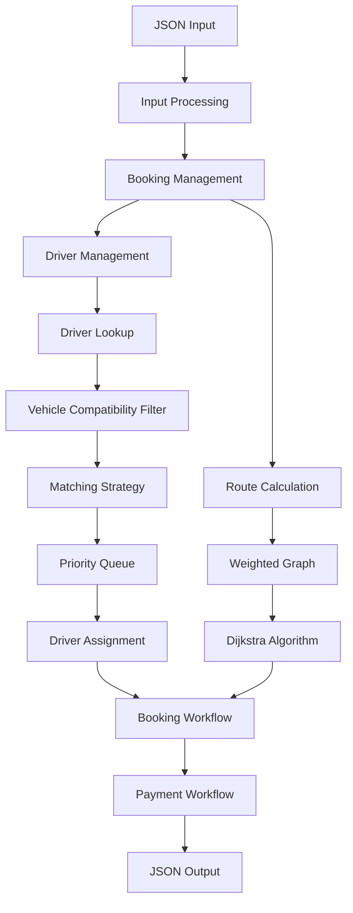

# RIDEX – System Architecture

## 1. Overview

RIDEX follows a modular C++ application architecture.

The system separates ride-booking operations, entity management, driver matching and route calculation into distinct responsibilities.

This separation helps keep the application organized and allows individual components to evolve independently.

## 2. High-Level Architecture

The system can be understood through the following logical layers:

### 2.1 Input and Interface Layer

Responsible for receiving ride-related input and presenting results.

The project uses a JSON-based input/output workflow.

Typical input information includes:
- Rider details.
- Pickup location.
- Destination.
- Vehicle requirements.

### 2.2 Application Layer

Coordinates the main operations of the system.

Responsibilities:
- Process ride requests.
- Coordinate booking operations.
- Invoke driver matching.
- Coordinate route calculation.
- Manage booking workflow.

### 2.3 Business Logic Layer

Contains the core ride-booking and driver-matching logic.

It handles:
- Vehicle compatibility checks.
- Driver selection.
- Matching strategy execution.
- Booking-related decisions.

### 2.4 Algorithm Layer

Contains the data structures and algorithms used by the application.

Core components include:
- unordered_map for driver lookup.
- priority_queue for priority-based selection.
- Adjacency lists for graph representation.
- Dijkstra's algorithm for shortest-path calculation.

### 2.5 Entity Layer

Represents the main objects used by the system:

- Rider
- Driver
- Vehicle
- Ride
- Booking
- Payment-related information

## 3. Architecture Diagram



## 4. Driver Matching Workflow

The driver-matching process follows these stages:

1. A ride request enters the booking system.
2. Candidate driver information is retrieved.
3. Vehicle compatibility is checked.
4. Eligible drivers are evaluated using a rating-distance-based score.
5. A priority queue organizes candidates.
6. A preferred driver is selected.
7. Driver assignment continues through the booking workflow.

## 5. Route Calculation Workflow

The route-calculation process uses graph-based modelling.

### Graph Representation

A location is represented as a vertex.

A connection between two locations is represented as an edge.

Each edge contains a non-negative weight representing its travel cost or distance.

Example:

```text
       A
      / \
     4   2
    /     \
   B---1---C
```

The graph is represented using an adjacency list.

Example:

```text
A -> (B, 4), (C, 2)
B -> (A, 4), (C, 1)
C -> (A, 2), (B, 1)
```

Dijkstra's algorithm processes this graph to calculate shortest paths.

## 6. Component Interaction

| Component | Interacts With | Responsibility |
|---|---|---|
| Input Processing | Booking Management | Receives ride information |
| Booking Management | Driver Matching | Requests a suitable driver |
| Driver Management | Matching Engine | Supplies driver information |
| Vehicle Management | Matching Engine | Supports compatibility checks |
| Matching Engine | Priority Queue | Organizes eligible candidates |
| Route Calculation | Graph Module | Calculates shortest paths |
| Booking Workflow | Payment Workflow | Coordinates booking-related operations |

## 7. Example End-to-End Workflow

Consider a rider requesting a vehicle from location A to location D.

1. The request enters the application.
2. The booking component processes the request.
3. The driver-management component provides candidate drivers.
4. The matching engine filters candidates by vehicle compatibility.
5. Eligible drivers are ranked using the matching logic.
6. A preferred driver is selected.
7. The route-calculation component calculates the shortest path.
8. Booking-related information is processed.
9. Payment-related operations continue through the workflow.
10. The application produces the corresponding output.

## 8. Error and Validation Considerations

The architecture should account for:

- Invalid ride requests.
- Missing pickup or destination information.
- No compatible drivers.
- Unreachable destinations.
- Invalid graph data.
- Booking-related failures.
- Payment-related failures.

These are design considerations and should be documented as implemented features only when supported by the source code.

## 9. Conclusion

The RIDEX architecture separates input processing, booking coordination, driver matching and route calculation.

This modular structure demonstrates how data structures, graph algorithms and object-oriented design can work together in a practical ride-booking application.
